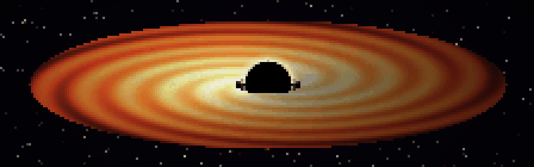
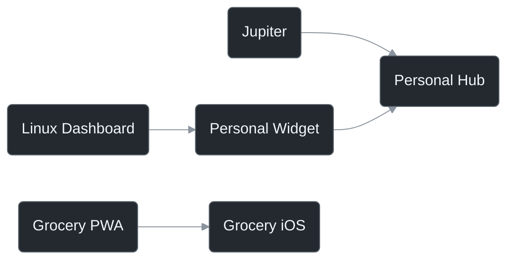

<h1 align="center">Hi, I'm Cristopher 👋</h1>

I build the software I live with: <b>AI agents</b>, <b>macOS tools</b> and an <b>always-on room display</b>.

 
TON 618 — an ultramassive black hole, ~66 billion solar masses

<b>NOW</b> &nbsp;·&nbsp; bringing Personal Hub up on its Windows host &nbsp;·&nbsp; shipping Grocery Tracker on iOS 26

## Stack

**Languages**

**Frameworks & Runtime**

**AI & Data**

**Automation & Integrations**

## Projects

### Personal Hub
A wall display running 24/7: alarms, routines, automations and a local tool-calling agent. A deterministic intent router handles everyday commands, so the small model on a GTX 1050 is only the fallback.
 ELECTRON · FASTAPI · SQLITE · CHROMADB · LM STUDIO &nbsp;🔒

### Jupiter
A personal AI assistant that routes across Claude, GPT and Gemini with 33 tools. Its "Doorman" triages Gmail, Instagram and TikTok messages and drafts replies for me to approve.
 FASTAPI · REACT · LITELLM · CHROMADB · PLAYWRIGHT &nbsp;🔒

### Personal Widget
A macOS widget that lives among the Finder icons and still takes clicks, made possible by a small Objective-C++ addon that sets the native window level.
 ELECTRON · REACT · OBJECTIVE-C++ &nbsp;🔒

### Grocery Tracker
An iPhone app that reads receipts on the device with Apple Intelligence and flags what has probably run out. No account, no server.
 SWIFT · iOS 26 · APPLE INTELLIGENCE &nbsp;🔒

<b>More projects</b>

 

| | |
|---|---|
| [**MyTime-Agent**](https://github.com/Farflan/MyTime-Agent) | Syncs my work schedule and answers questions about it with Claude |
| [**AI-Fitness-Nutrition-Agent**](https://github.com/Farflan/AI-Fitness-Nutrition-Agent) | Macro tracker with an AI nutrition coach |
| **Mac File Organizer** 🔒 | Previews every move first, with a one-command undo and an MCP server |
| **Obsidian Note Taker** 🔒 | Auto-tags and links notes with a local Ollama model |
| **Family Dashboard** 🔒 | Kitchen screensaver with live weather and a sun-and-moon horizon |

## How it connects

Each project borrows from the one before it.

---

<i>If it doesn't survive daily use, it doesn't ship.</i> &nbsp;·&nbsp; 🔒 private repo

